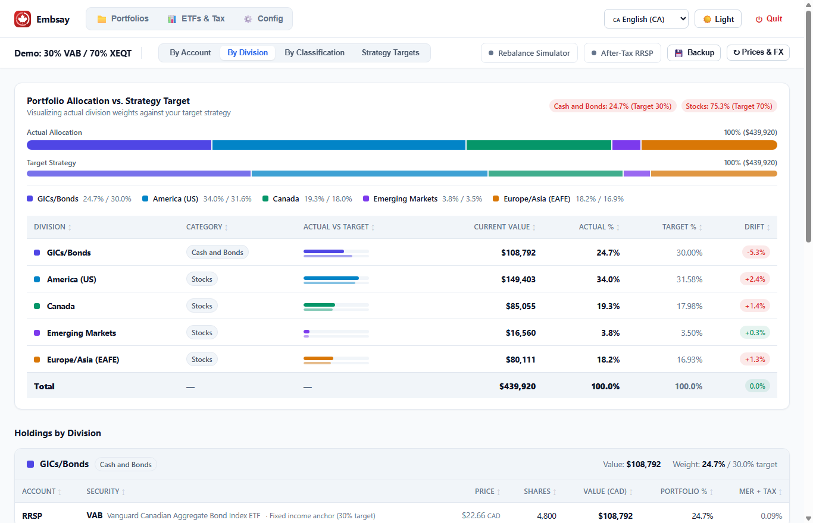
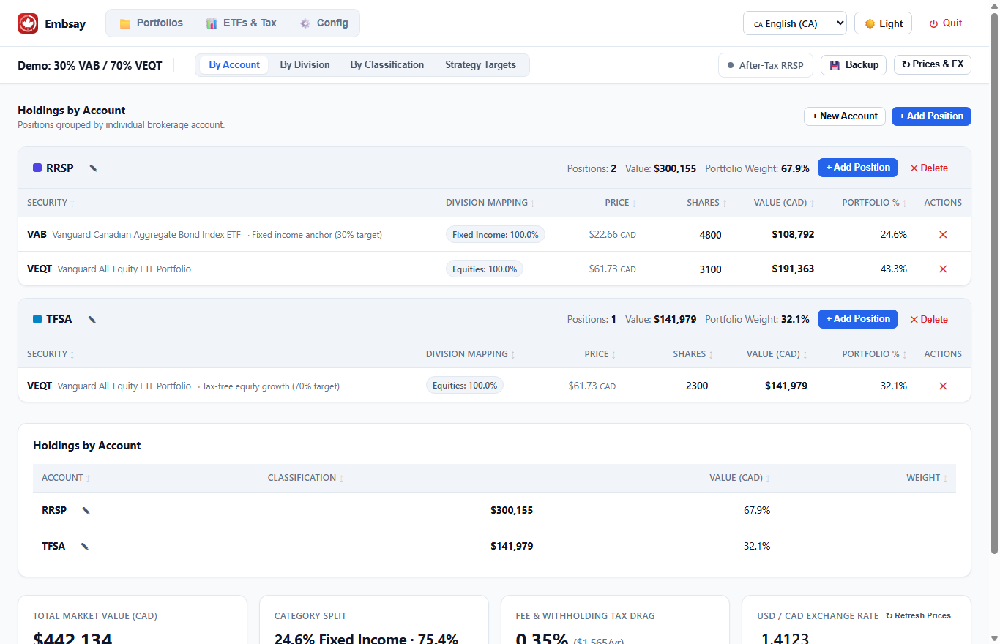
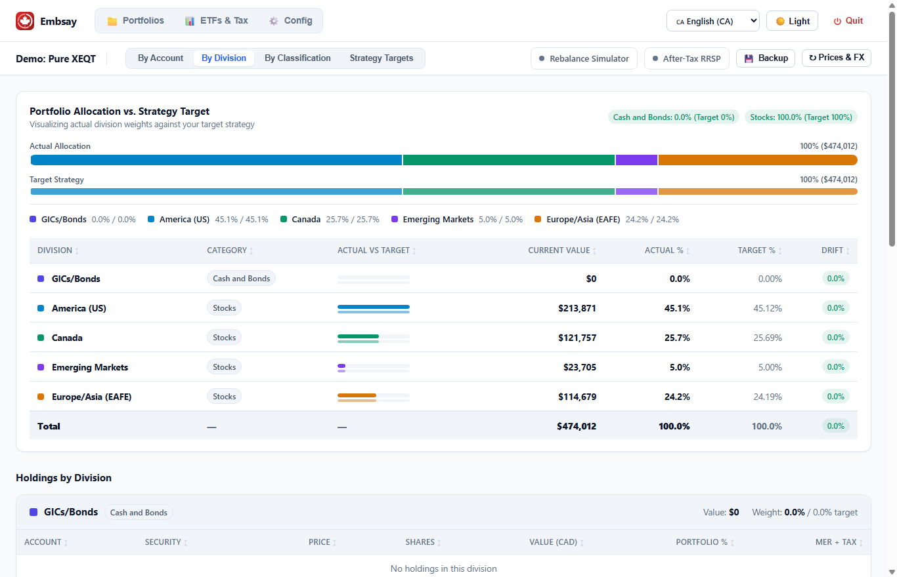
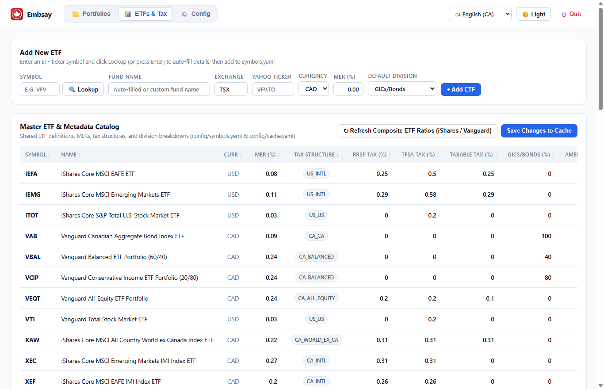
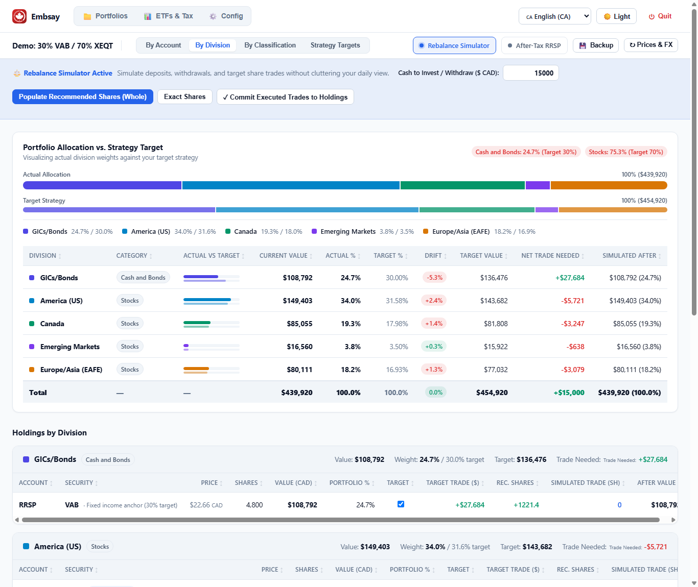
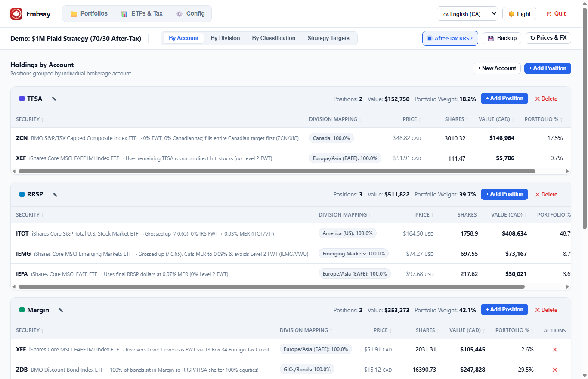

# Embsay 🍁

[](https://github.com/CameronEllum/Embsay/actions/workflows/test.yml)
[](https://github.com/CameronEllum/Embsay/releases)
[](https://go.dev)
[](LICENSE)

**Embsay** is a local-first portfolio visualizer, rebalance simulator, and after-tax asset location engine built specifically for Canadian DIY index investors.

It eliminates the spreadsheets and manual math required to coordinate Canadian accounts (**TFSA**, **RRSP/RRIF**, and **Non-Registered/Margin**). Embsay automatically decomposes composite asset allocation ETFs (`XEQT`, `VEQT`, `XAW`, `VBAL`), normalizes US and Canadian dollars using live Bank of Canada daily exchange rates, tracks foreign withholding tax (FWT) drag, and calculates exact rebalancing trades when new savings arrive.

### Core Capabilities
* 🇨🇦 **Canadian Tax-Shelter Native**: Built around **TFSA**, **RRSP/RRIF**, and **Non-Registered / Margin** accounts.
* 🔍 **ETF Look-Through & Decomposition**: Breaks composite funds (`XEQT`, `VEQT`, `XAW`, `VBAL`, `VCIP`) down into underlying regional equity slices (Canada, US, Developed EAFE, Emerging Markets) and fixed income.
* 💸 **Foreign Withholding Tax Drag Tracking**: Visualizes unrecoverable Level 1 and Level 2 FWT drag across account types alongside fund MERs.
* 💱 **Multi-Currency Normalization**: Normalizes CAD and USD holdings automatically using daily exchange rates.
* 🔒 **100% Private & Local**: Zero accounts, zero cloud servers, and zero telemetry. All data is stored in plain, transparent YAML files on your computer.

---

## Table of Contents

* [Operation](#operation)
  * [Desktop Lifecycle](#desktop-lifecycle)
  * [Custom Paths, Household Groups & Backups](#custom-paths-household-groups--backups)
  * [Recipes for Downloading Market Data](#recipes-for-downloading-market-data)
* [Portfolio Examples](#portfolio-examples)
  * [1. Hierarchical Regional Decomposition (30% VAB / 70% XEQT)](#1-hierarchical-regional-decomposition-30-vab--70-xeqt)
  * [2. Classic Two-Fund Flat Allocation (30% VAB / 70% VEQT)](#2-classic-two-fund-flat-allocation-30-vab--70-veqt)
  * [3. Pure One-Ticket ETF (100% XEQT Across Accounts)](#3-pure-one-ticket-etf-100-xeqt-across-accounts)
  * [4. Master Securities Catalog & Tax Drag Reference](#4-master-securities-catalog--tax-drag-reference)
* [Portfolio Rebalancing](#portfolio-rebalancing)
* [After-Tax Portfolio Allocation & The Plaid Strategy](#after-tax-portfolio-allocation--the-plaid-strategy)
* [Quick Start Guide](#quick-start-guide)
  * [Running Embsay on Windows](#running-embsay-on-windows)
  * [Running on macOS or Linux](#running-on-macos-or-linux)
* [Privacy by Design](#privacy-by-design)
* [Disclaimer](#disclaimer)
* [License](#license)

---

## Operation

### Desktop Lifecycle
Embsay runs as a lightweight, self-contained local web utility:

* 🚀 **Automatic Browser Launch on Windows**: Double-clicking `embsay.exe` starts the local engine and immediately opens your default web browser to your dashboard—no terminal commands or web addresses required.
* ⏻ **One-Click Quit**: Click the **Quit** button in the top header to cleanly shut down the application at any time.
* ⏱️ **Idle Auto-Shutdown**: If you close the browser tab or step away, Embsay automatically exits after a period of inactivity (defaults to 1 hour, configurable in the Config tab) so background processes never linger.

### Custom Paths, Household Groups & Backups
* 📁 **Custom Portfolio Paths & Folders**: Store your portfolio YAML files wherever you like—in your personal `Documents/`, a private `OneDrive` folder, or an external drive. Add multiple folders in the **Config** tab (or browse visually via the folder picker) and Embsay will load every portfolio across those directories.
* 👨‍👩‍👧 **Household Portfolio Groups**: Combine multiple individual portfolios (for example, spouses or separate tax accounts) into unified **Portfolio Groups** to view aggregate net worth and rebalance across your entire household.
* 💾 **Automatic Timestamped Backups**: Every edit automatically saves a timestamped backup in the same directory (e.g., `my_portfolio_backup_2026-11-09_210000.yaml`), alongside scheduled weekly safety backups.

### Recipes for Downloading Market Data
Rather than hardcoding web scrapers or locking you into a single data vendor, Embsay uses transparent, user-editable **declarative YAML recipes** (`config/data_sources.yaml`) to retrieve market data on demand:

* **Exchange Rates**: Fetches official daily `USD/CAD` closing rates directly from the **Bank of Canada Valet API**, with automatic fallback to Yahoo Finance if needed.
* **Live Security Prices**: Queries the **Yahoo Finance Chart API** (`v8`) to look up prices and currencies for Canadian (`.TO`) and US-listed ETFs, and supports optional alternative REST providers (such as Twelve Data) via custom JSON path mappings.
* **Composite ETF Weight Recipes**: Automatically refreshes the geographic asset breakdowns of all-in-one ETFs directly from fund providers—downloading BlackRock iShares Canada holdings CSV exports (e.g., `XEQT`, `XAW`) and parsing Vanguard Canada product allocation tables (`VEQT`, `VBAL`, `VCIP`).
* **Brokerage CSV Importers**: Built-in column-mapping recipes let you import position exports directly from **Questrade** and **Wealthsimple** CSV files.
* **Extensible via Plugins**: Want to add a different ETF provider, price source, or brokerage CSV format? Drop an extra `.yaml` recipe file into the `plugins/` folder and Embsay picks it up automatically.

---

## Portfolio Examples

Embsay adapts to any Canadian index investing approach, from minimalist one-ticket setups to custom multi-ETF strategies.

### 1. Hierarchical Regional Decomposition (30% VAB / 70% XEQT)
Hold an all-in-one equity fund alongside aggregate bonds? Embsay decomposes composite ETFs into their underlying regional equity sleeves (**US**, **Canada**, **Developed EAFE**, and **Emerging Markets**) so you can monitor and rebalance your true global geographic exposure.



### 2. Classic Two-Fund Flat Allocation (30% VAB / 70% VEQT)
For classic Couch Potato simplicity, configure a flat strategy comparing just two high-level targets: **Fixed Income** and **Equities**.



### 3. Pure One-Ticket ETF (100% XEQT Across Accounts)
Holding a single all-in-one fund across multiple accounts (`TFSA`, `RRSP`, `Non-Registered`)? Embsay consolidates your account balances, total household net worth, and underlying geographic exposures in one view.



### 4. Master Securities Catalog & Tax Drag Reference
Inspect fund MERs, underlying division weights, and estimated foreign withholding tax (FWT) drag across different account types (`TFSA`, `RRSP`, `Non-Registered`), or trigger one-click refreshes for prices and composite ETF breakdowns.



---

## Portfolio Rebalancing

When new savings arrive or market movements cause drift, the **Rebalance Simulator** calculates the exact purchases required to bring your portfolio back on target.



1. **Enter Cash to Invest**: Type your contribution into **Cash to Invest / Withdraw ($ CAD)** (for example, `$15,000`).
2. **Instant Drift Detection**: Embsay compares current holdings against your target weights. In the example above, **Bonds (`VAB`)** sit at **24.7%** against a **30.0% target** (**-5.3% drift** / `$27,684` underweight), while **Equities** are overweight at **75.3%**.
3. **Proposed Purchases**: Embsay allocates your new cash directly toward underweight divisions and recommends exact share quantities (e.g., **+662 shares of VAB**).
4. **Deposit-Only Rebalancing**: By directing new contributions to lagging assets, you can rebalance without triggering unnecessary taxable sales.
5. **One-Click Commit**: After placing your trades at your brokerage, click **Commit Executed Trades to Holdings** to update your share counts and save a backup automatically.

---

## After-Tax Portfolio Allocation & The Plaid Strategy

Most portfolio trackers treat \$100,000 inside an RRSP identically to \$100,000 inside a TFSA. In reality, every dollar withdrawn from an RRSP/RRIF is subject to future income tax. Treating pre-tax and after-tax dollars equally leads investors to hold more effective equity risk than intended.



1. **Configurable Withdrawal Tax Rate**: Specify your expected effective retirement tax rate (e.g., 30% or 35%) per portfolio.
2. **After-Tax Net Worth Discounting**: Embsay discounts RRSP/RRIF balances by your withdrawal tax rate:
   $$\text{After-Tax Value} = \text{Market Value} \times (1 - \text{Tax Rate})$$
   while TFSA and Non-Registered accounts remain weighted at 100%.
3. **The Plaid Strategy (Asset Location)**: Allocate tax-efficient assets across account wrappers:
   * **TFSA**: Canadian equities (**ZCN / XIC**) for 0% FWT and tax-free growth.
   * **RRSP**: US-listed US and Emerging Market ETFs (**ITOT / VTI**, **IEMG / VWO**) to eliminate IRS withholding tax under the Canada–US tax treaty and capture lower MERs, grossed up to reflect after-tax weight.
   * **Non-Registered / Margin**: Developed international equities (**XEF**) to recover foreign withholding tax via T3 Box 34 Foreign Tax Credits, alongside tax-efficient discount bonds (**ZDB**).

---

## Quick Start Guide

### Running Embsay on Windows
1. Download the Windows archive from the [latest release](https://github.com/CameronEllum/Embsay/releases) and extract it.
2. Double-click `embsay.exe`.
3. Your default web browser will automatically open to `http://localhost:8080`.
4. Explore the included example portfolios or click **+ New Portfolio** to build your own.
5. When finished, click **Quit** in the header to exit cleanly.

### Running on macOS or Linux

> [!NOTE]
> **Untested on macOS and Linux**: While automated unit tests compile and pass on `ubuntu-latest` and `macos-latest` runners, Embsay has only been run and used interactively on Windows. Running the desktop binary on macOS or Linux is currently untested.

1. Download the macOS or Linux archive from the [latest release](https://github.com/CameronEllum/Embsay/releases) and extract it.
2. Run the executable from your terminal:
   ```bash
   ./embsay
   ```
3. Open `http://localhost:8080` in your web browser.

---

## Privacy by Design

Embsay was designed around complete local privacy:

* **100% Local**: Runs entirely on your own machine—no user accounts, no cloud databases, and no analytics.
* **Safe Version Control Defaults**: Personal `portfolios/` and user configuration files are excluded from Git tracking by default.
* **Transparent Data Format**: All portfolios and settings live in readable YAML files that you own and control.

---

## Disclaimer

*Embsay is a portfolio visualization and simulation tool intended for informational and educational purposes only. It does not provide financial, investment, legal, or tax advice. Calculations such as after-tax discounting and foreign withholding tax drag are estimates based on user-provided inputs and simplified models. Consult a qualified professional accountant or fee-only financial planner for your specific tax and investment situation.*

---

## License

This project is licensed under the [MIT License](LICENSE).
